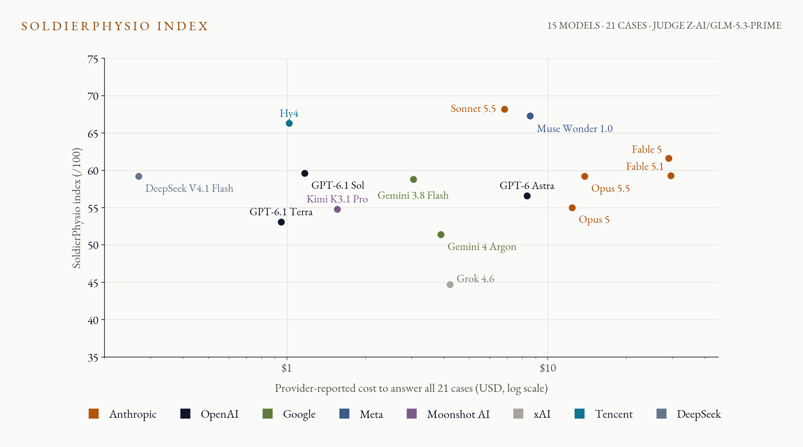
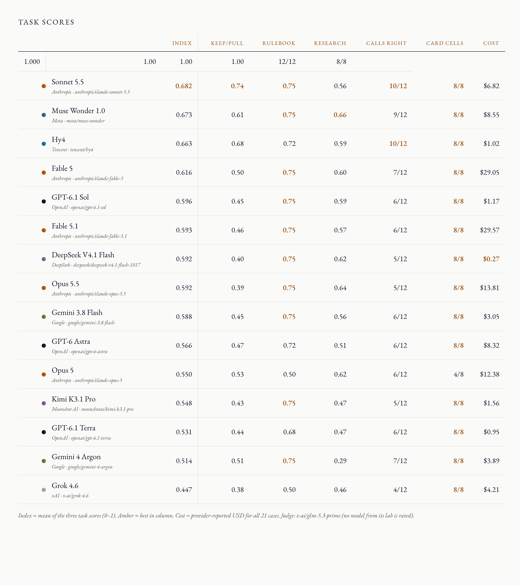
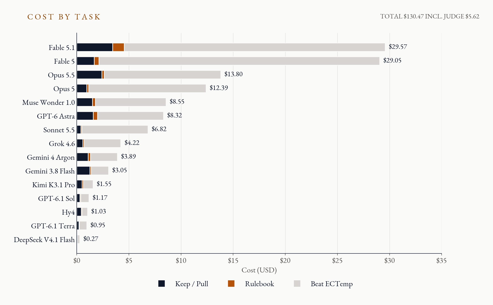
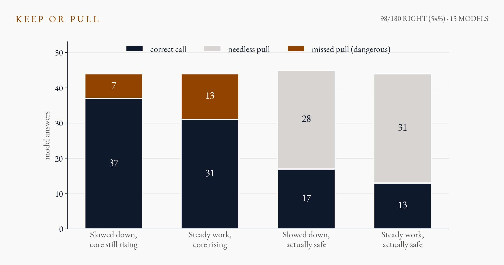

# SoldierPhysio-bench

**Can frontier models keep a soldier out of heat stroke?**

**Video walkthrough:** TODO_VIDEO_LINK  
**Results site:** [https://soliderphys-bench.pages.dev](https://soliderphys-bench.pages.dev) (source in [`site/`](site/); `cd site && npm install && npm run dev` for localhost)



## Short description

A medic watching a soldier work in the heat has a heart-rate strap, a skin-temperature
sensor, the work rate, the weather, and the Army heat card (TB MED 507). The medic has no
core thermometer, yet must make the same call repeatedly: keep this soldier going, or pull
them now.

SoldierPhysio-bench tests whether frontier models can make that call. Each model receives
the medic's view of real heat-chamber data, where the true core temperature is known, and
must do three things: decide keep or pull, recite and apply the current heat card, and
build a better core-temperature estimator than an ECTemp-style baseline.

**Headline finding.** Across 15 frontier models, keep/pull calls were right 98 of 180
times (54%), close to a coin flip. Most misses were needless pulls (59), not missed pulls
(20). Asked from memory, 18 of 28 rulebook answers recited the superseded 2003 card (40/20
work/rest) instead of the current 2022 card ("NL", no limit). Handed the 2022 card, every
answer read it correctly, yet 27 of 29 still overrode it, including for the soldier who was
fine. The best model scored 68.2/100.

## What it tests

Whether a model can apply field-specific operational knowledge under uncertainty. The
models fail in two places: they cite an out-of-date edition of the governing rulebook, and
they cannot reliably tell which hot, hard-working soldier is actually safe. They do not
fail at arithmetic or code, and the research task shows they can fit a predictor.

## Who it is for and why it matters

Heat illness is a rising and preventable problem for the Army. In 2024 the active
component recorded 36.4 heat strokes and 183.9 heat-exhaustion cases per 100,000
person-years, and heat exhaustion has increased every year since 2020 (MSMR, June 2025).
LLMs are being proposed as decision aids for medics and small-unit leaders.

The audience is anyone deciding whether to put a model in a heat-casualty loop: military
medical teams, wearable vendors, and labs claiming medical reasoning. The cost of failure
runs in both directions. A missed pull risks a heat stroke. A needless pull costs training
time and teaches leaders to ignore the aid.

**Domain and expertise.** Military heat-illness prevention and exercise thermophysiology:
the TB MED 507 work/rest and water tables; thermal lag, where core temperature keeps
climbing after work drops; heart-rate-based core estimation (USARIEM ECTemp, Buller et al.
2013); and the practical judgment of when a hot soldier is still safe. Ground truth is
measured rectal temperature from a published human heat-chamber study, not a model's
opinion.

## Task overview

Three task types, 21 frozen cases. The cases are built around judgment calls, not easy
ones.

| Task | Cases | Model's job | Why it is hard |
|---|---:|---|---|
| [Keep going or pull him?](tasks/keep_going/README.md) | 12 | From 25 minutes of wearable and chamber data, forecast core temperature at +15 min and decide KEEP or PULL (PULL iff measured core ≥ 38.5 °C) | Some soldiers slow down while core keeps rising (thermal lag). Some slow down and are safe. Some hold steady power and climb, some hold steady and are fine, and one case pairs a quiet wearable with a hot core. |
| [Rulebook versus body](tasks/rulebook_vs_body/README.md) | 2 | (a) Recite the TB MED 507 (2022) cell for the flag and work category. (b) FOLLOW the card or OVERRIDE it and pull now | The 2022 card changed the 2003 value for this cell (40/20 became NL). A model working from memory of the older edition answers fluently and wrongly. |
| [Beat ECTemp](tasks/beat_ectemp/README.md) | 7 (2 sessions) | Agentic research: write a causal `predict()` for core temperature (3A: +15 min forecast after work drops; 3B: current estimate) | The predictor must generalise to hidden people and beat a frozen baseline, and it must be causal. |

Each task lists the exact prompt, inputs and output schema in its own README. Everything the
grader checks (the 38.5 °C cutoff, the horizon, the four card fields, the output schema) is
stated in the prompt.

## Grading

Per-case weights are frozen in [`tasks/combined_score.py`](tasks/combined_score.py):

- **Keep/Pull:** 0.40 decision + 0.30 forecast (`1 - error / E`, code) + 0.30 reasoning.
- **Rulebook:** 0.30 table lookup (code, exact match on 4 TB MED 507 fields) + 0.40
  override decision + 0.30 reasoning.
- **Beat ECTemp:** 0.60 predictor (`1 - MAE / baseline MAE` on hidden people, code) + 0.40
  research explanation.

Decision, override, reasoning and research explanation are LLM-judge marks (0 to 5, see
[LLM judge](#llm-judge)). Code still decides whether each call was right, against measured
core temperature at +15 min, and the judge must cap a wrong call at 1.

The overall score is the mean of the three task means, so the 12-case task cannot drown
out the others. A missing answer scores 0. Constants are in
[`tasks/scoring_params.json`](tasks/scoring_params.json). The outcome is graded, not the
path: the code graders read the decision, number, table cell or saved predictor, never the
steps taken.

### Reference solutions and grader validation

The unit tests (`python -m unittest discover -s tests`) run reference answers and
deliberately wrong answers through every deterministic grader.

- *Reference answers pass.* The ground-truth decision and the measured core temperature
  score 1.0 on every Keep/Pull case. The full TB MED 507 (2022) cell plus the correct
  decision scores 1.0 on both Rulebook cases (`test_score_all_perfect`,
  `test_perfect_answers`, `test_perfect_suite`). For Beat ECTemp, the reference is
  [`reference_predictor.py`](tasks/beat_ectemp/reference_predictor.py): the mean core
  temperature of the 14 training people at each minute of the session, with a 90% interval
  of ±0.5 °C. It is fit on the public training split only, and a test rebuilds the table
  from `train.json` to confirm that. On the hidden people it beats the frozen baseline in
  both tasks (3A MAE 0.315 vs 0.443 °C; 3B 0.281 vs 0.506 °C) and passes the grader
  (`test_reference_beats_baseline_on_hidden_people`). It does not win every person: it
  loses to the baseline on H06 in both tasks, and I did not tune it to fix that. Adding
  heart rate, skin temperature, watts, mass or age did not improve it in leave-one-out
  checks on the training people. The models themselves also show the task is solvable:
  76 of 98 person-cases beat the baseline.
- *Wrong answers fail.* The 2003 card value (40/20) fails the rulebook half
  (`test_old_2003_card_fails_rulebook_half`). Always-KEEP, always-PULL and the shortcut
  "power dropped, so keep going" each score exactly 50% on Keep/Pull and catch no
  thermal-lag case (`test_constant_guesses_score_half`,
  `test_power_drop_heuristic_scores_half`). Missed and false overrides, unparsed output
  and a missing table key are all graded as errors.
- *No false fails on format.* Equivalent spellings ("no limit", "¾ qt/hr", "1 quart/hour")
  are accepted (`test_flexible_rulebook_spellings_still_match`).
- *Gaming.* Beat ECTemp scores against the frozen baseline, the baseline itself scores 0,
  and the hidden labels never enter the model's sandbox
  (`test_real_sandbox_blocks_labels_network_and_budget`).

### LLM judge

The judge is `z-ai/glm-5.3-prime` (GLM-5.3 Prime), run in JSON mode at high reasoning
effort. No model from its lab is on the roster, and the harness refuses a judge from any
rated lab (`check_judge_model` in [`tasks/combined_score.py`](tasks/combined_score.py)).
Prompt and rubrics: [`tasks/judge.py`](tasks/judge.py) and
[docs/LLM_JUDGE_RUBRICS.md](docs/LLM_JUDGE_RUBRICS.md).

It is told the verified outcome first (measured core temperature, the model's exact error,
whether the call was right), then reads only the final answer and marks each dimension 0 to
5, quoting the answer for every mark. A right call gets 5 when well supported, 3 to 4 when
it omits a material risk, and 2 when it is essentially lucky. A wrong call gets at most 1,
and its reasoning at most 2. A research explanation whose predictor lost to the baseline is
capped at 3 unless it flagged that risk. Length and confidence earn nothing. A malformed
verdict gets one retry, after which the case is not scorable rather than zero.

**Judge change.** Until 2026-11-15 the judge was `openai/gpt-6.1-sol-pro`. It was retired
when GPT-6.1 Sol joined the roster, and every saved answer was re-judged by GLM-5.3 Prime
([`scripts/rejudge_off_roster.py`](scripts/rejudge_off_roster.py), $5.62). No model
answers were rerun for this.

Reliability (`judge_agreement` in the board JSON, no API calls):

- *Agreement with the code grader.* The decision mark agreed with code on 206 of 207
  scored calls (wrong calls 0 to 2, right calls 3 to 5). The exception is Opus 5 on KG-11:
  the code grader could not parse the answer, the judge read KEEP in the text and gave 5
  instead of the capped 1. It is left as scored and adds about 1.6 points to Opus 5's
  overall.
- *Against the retired judge, same answers.* Same decision mark on 67% of 166 pairs (99%
  within one point), same override mark on 24 of 27, same reasoning mark on 52% of 193
  (76% within one), same research mark on 38% of 87 (90% within one). GLM is more lenient,
  +0.6 on reasoning and +0.7 on research explanations on average, so 12 of the 14
  re-judged models rose by 2 to 11 points. The two OpenAI models fell (GPT-6 Astra -1.4,
  GPT-6.1 Terra -2.3). That fits the retired OpenAI judge favouring its own lab, but one
  run per case cannot show it.
- *Limits.* Each answer was judged once (4 were retried after unparseable output), so
  there is no test-retest for this judge yet. Because the judge sees the verified outcome,
  its decision mark mostly restates the code grade, but the judge still sets 70% of the
  Keep/Pull and Rulebook scores. Every headline finding rests on code grades only. I
  reviewed the judge prompt and rubrics (unchanged across judges) and the earlier judge's
  verdicts on saved answers; an outside reviewer, kept anonymous here, also vetted the
  setup. Both were qualitative reviews, not a scored inter-rater study.

## How to run

Requirements: Python 3.12 or 3.13 (scipy 1.15.3 has no 3.14 wheel), macOS or Linux, and an
[OpenRouter](https://openrouter.ai) key. Dependencies are pinned in `requirements.txt`.

```sh
python3.13 -m venv .venv && . .venv/bin/activate
pip install -r requirements.txt
cp .env.example .env            # then paste your key: OPENROUTER_API_KEY=...
python -m unittest discover -s tests       # 190 tests, ~5 s, no key needed
```

**Re-score the saved run (no key, no cost, about 10 s).** This rebuilds the leaderboard
below, and the judge agreement figures, from the raw outputs and judgments in `results/`:

```sh
ln -s results .benchmark-runs     # in the submission zip only: the board records .benchmark-runs/ paths
python scripts/rejudge_off_roster.py board
```

**Run a model from scratch.** Example using the cheapest roster model on all 21 cases:

```sh
python -m eval_suite preflight --backend local      # use macos-development on a Mac
python -m eval_suite run --model deepseek/deepseek-v4.1-flash-1017 --tasks all \
  --spend-cap-usd 5 --backend local --out runs/deepseek
python -m tasks.judge runs/deepseek/submissions.json --judge openrouter --spend-cap-usd 5 \
  --out runs/deepseek/judged.json
python -m tasks.combined_score runs/deepseek/judged.json --params tasks/scoring_params.json \
  --out runs/deepseek/rating.json
```

Add `--tasks keep-going-or-pull-him,rulebook-versus-body` to skip the agentic task. Official
agentic runs use the Docker backend (`--image`); the local backends are development
sandboxes (see Technical reference). To refresh the results site data
(`site/lib/soldier.json`, `site/public/traces/cases.json`) run
`python scripts/build_site_data.py`, then `python scripts/make_index_charts.py` to redraw
the figures from the same data.

## Cost and runtime

The 14 single-turn cases take a few minutes per model and cost cents on cheap models and a
few dollars on the largest. Beat ECTemp is agentic (up to 1,200 s and 64 turns per
session, two sessions), so a full model run takes up to about 45 minutes. The
published 15-model board cost **$130.47** provider-reported: $124.85 for model answers and
$5.62 for the judge. The retired Sol Pro judge had cost another $16.67. Per-model cost is in the
results table below. A single request reserves its full output ceiling against the spend
cap (up to about $6.40 on the largest models), so set `--spend-cap-usd` accordingly.

## Results

Answers were collected through OpenRouter on **2026-11-07 and 2026-11-08** (Keep/Pull,
Beat ECTemp), **2026-11-14** (Rulebook, rerun with the 2022 card in the prompt) and
**2026-11-15** (GPT-6.1 Sol, all 21 cases). Every answer was judged by GLM-5.3 Prime on
2026-11-15. 15 models, 21 frozen cases each, **one run per case**. Temperature was not set
(provider default). Reasoning effort follows [`eval_suite/roster.json`](eval_suite/roster.json):
`max` for 11 models (sent to OpenRouter as `xhigh`), `xhigh` for 1, `high` for 3. The
output budget was 131,072 tokens. The single-turn tasks had no tools, browsing or retrieval.

| Rank | Model (OpenRouter ID) | Keep/Pull | Rulebook | Research | Overall /100 |
|---:|---|---:|---:|---:|---:|
| 1 | Sonnet 5.5 (`anthropic/claude-sonnet-5.5`) | 73.6 | 75.0 | 56.1 | **68.2** |
| 2 | Muse Wonder 1.0 (`meta/muse-wonder`) | 61.3 | 75.0 | 65.7 | **67.3** |
| 3 | Hy4 (`tencent/hy4`) | 68.2 | 72.0 | 58.7 | **66.3** |
| 4 | Fable 5 (`anthropic/claude-fable-5`) | 49.7 | 75.0 | 60.1 | **61.6** |
| 5 | GPT-6.1 Sol (`openai/gpt-6.1-sol`) | 44.5 | 75.0 | 59.2 | **59.6** |
| 6 | Fable 5.1 (`anthropic/claude-fable-5.1`) | 45.9 | 75.0 | 56.9 | **59.3** |
| 7 | DeepSeek V4.1 Flash (`deepseek/deepseek-v4.1-flash-1017`) | 40.4 | 75.0 | 62.2 | **59.2** |
| 8 | Opus 5.5 (`anthropic/claude-opus-5.5`) | 38.9 | 75.0 | 63.6 | **59.2** |
| 9 | Gemini 3.8 Flash (`google/gemini-3.8-flash`) | 45.0 | 75.0 | 56.5 | **58.8** |
| 10 | GPT-6 Astra (`openai/gpt-6-astra`) | 46.5 | 72.0 | 51.4 | **56.6** |
| 11 | Opus 5 (`anthropic/claude-opus-5`) | 53.3 | 50.0 | 61.6 | **55.0** |
| 12 | Kimi K3.1 Pro (`moonshotai/kimi-k3.1-pro`) | 42.7 | 75.0 | 46.7 | **54.8** |
| 13 | GPT-6.1 Terra (`openai/gpt-6.1-terra`) | 43.7 | 68.0 | 47.5 | **53.1** |
| 14 | Gemini 4 Argon (`google/gemini-4-argon`) | 50.5 | 75.0 | 28.6 | **51.4** |
| 15 | Grok 4.6 (`x-ai/grok-4.6`) | 37.6 | 50.0 | 46.3 | **44.7** |



**Run summary in the guide's format.** Pass rates are deterministic (code-graded only).
There was one trial per task, so pass^k cannot be computed (see Limits).

| Model (OpenRouter ID, roster effort) | Trials per task | Keep/Pull decisions right | Card cells right | Overrides right | Predictors beating baseline | Cost per full run |
|---|---:|---:|---:|---:|---:|---:|
| Sonnet 5.5 (`anthropic/claude-sonnet-5.5`, max) | 1 | 10/12 (83%) | 8/8 | 1/2 | 5/7 | $6.82 |
| Muse Wonder 1.0 (`meta/muse-wonder`, max) | 1 | 9/12 (75%) | 8/8 | 1/2 | 5/7 | $8.55 |
| Hy4 (`tencent/hy4`, high) | 1 | 10/12 (83%) | 8/8 | 1/2 | 6/7 | $1.02 |
| Fable 5 (`anthropic/claude-fable-5`, max) | 1 | 7/12 (58%) | 8/8 | 1/2 | 5/7 | $29.05 |
| GPT-6.1 Sol (`openai/gpt-6.1-sol`, max) | 1 | 6/12 (50%) | 8/8 | 1/2 | 5/7 | $1.17 |
| Fable 5.1 (`anthropic/claude-fable-5.1`, max) | 1 | 6/12 (50%) | 8/8 | 1/2 | 5/7 | $29.57 |
| DeepSeek V4.1 Flash (`deepseek/deepseek-v4.1-flash-1017`, max) | 1 | 5/12 (42%) | 8/8 | 1/2 | 6/7 | $0.27 |
| Opus 5.5 (`anthropic/claude-opus-5.5`, max) | 1 | 5/12 (42%) | 8/8 | 1/2 | 5/7 | $13.81 |
| Gemini 3.8 Flash (`google/gemini-3.8-flash`, high) | 1 | 6/12 (50%) | 8/8 | 1/2 | 5/7 | $3.05 |
| GPT-6 Astra (`openai/gpt-6-astra`, max) | 1 | 6/12 (50%) | 8/8 | 1/2 | 5/7 | $8.32 |
| Opus 5 (`anthropic/claude-opus-5`, max) | 1 | 6/12 (50%) | 4/8 | 1/2 | 5/7 | $12.38 |
| Kimi K3.1 Pro (`moonshotai/kimi-k3.1-pro`, max) | 1 | 5/12 (42%) | 8/8 | 1/2 | 6/7 | $1.56 |
| GPT-6.1 Terra (`openai/gpt-6.1-terra`, max) | 1 | 6/12 (50%) | 8/8 | 1/2 | 6/7 | $0.95 |
| Gemini 4 Argon (`google/gemini-4-argon`, high) | 1 | 7/12 (58%) | 8/8 | 1/2 | 7/7 | $3.89 |
| Grok 4.6 (`x-ai/grok-4.6`, xhigh) | 1 | 4/12 (33%) | 8/8 | 0/2 | 5/7 | $4.21 |

Scores mix deterministic and judged components and are not accuracy percentages. With one
run per case, a gap of a few points between models is noise, so no single model's rank
should be read as a finding. The spread that is meaningful is the pooled one: across all
models, keep/pull accuracy sat between 33% and 83% per model and averaged 54%. Every raw
answer, grade and judgment is under `results/`;
`results/rejudge-glm-20261115/final-leaderboard.json` names the source of every scored
case. The per-model reports in [docs/results/](docs/results/) describe the earlier
closed-book run under the retired judge.

**Pricing.** Spend barely tracks quality. The 21 cases cost $0.27 on DeepSeek V4.1 Flash
and $29.57 on Fable 5.1, about 110x apart. Sonnet 5.5 led the board for $6.82, Hy4 was
within two points for $1.02, and GPT-6.1 Sol placed fifth for $1.17. Beat ECTemp took 84%
of model spend ($104.80 of $124.85, judge excluded), although the cheap single-turn
questions are where the models fail hardest.



### Where models fail, and where they came close


**1. From memory, the rulebook is out of date.** Both rulebook cases are Moderate work at
Yellow flag (Heat Category 3). The current card (TB MED 507, 12 April 2022) prescribes
work/rest **NL** (no limit), 0.75 qt/h water, continuous work NL, and 1 qt/h for
continuous work. The 2003 card prescribed 40/20. In the first run (2026-11-07/08, 14
models, no card in the prompt; chart above), 18 of 28 answers gave 40/20, 1 gave 20/40, 1
gave 50/10, 5 gave nothing, and only 3 said NL. The models answered confidently, in the
right format, from the wrong edition. With the 2022 tables printed in the prompt, all 29
answers that came back read all four cells correctly; the 30th (Opus 5, RB-01) was a
content-filter refusal. The scored board uses the card-in-prompt run, so the Rulebook score
now measures the override call, not recall. Transcripts:
[40/20 answer](transcripts/rulebook-2003-card.md) (Sonnet 5.5, no card) and
[a correct NL answer](transcripts/rulebook-correct-NL.md) (Sonnet 5.5, card supplied).



**2. Keep or pull is close to chance, and the errors lean toward over-caution.** Pooled
across models, 98 of 180 calls were correct. By case type (deterministic grader):

| Case design | Correct | False pull | Missed pull |
|---|---:|---:|---:|
| Falling power, core still rising (thermal lag) | 37 | – | 7 |
| Steady power, core rising | 31 | – | 13 |
| Falling power, actually safe | 17 | 28 | – |
| Steady power, safe | 13 | 31 | – |

Models mostly catch thermal lag. They fail at the reverse judgment, telling which hot,
hard-working soldier is actually fine: they pulled 59 of 90 safe cases, and all three
OpenAI models pulled every safe soldier. They also missed 13 steady-power cases where core
was rising, which is the dangerous direction. Forecast MAE ranged from 0.22 to 0.42 °C,
about the size of the margin around the 38.5 °C cutoff. Three answers could not be parsed
and count as wrong. Transcripts: [needless pull](transcripts/keep-pull-false-pull.md)
(Muse Wonder 1.0), [missed pull](transcripts/keep-pull-missed-pull.md) (Sonnet 5.5), and
[thermal lag caught](transcripts/keep-pull-thermal-lag-caught.md) (Hy4).

**Where models came close.** Thermal-lag cases: 37 of 44 calls were right, the best
result on any case type. What tripped them was the reverse judgment: the same falling-power
pattern in a soldier who was actually safe produced 28 false pulls.

**3. Override judgment ignores the data.** The two rulebook cases are a matched pair: a
soldier with a quiet wearable whose core is climbing past 38.5 °C (override and pull), and
a soldier with an alarming heart rate whose core stays safe (follow the card). Of 29 usable
answers, 27 overrode the card, and 13 models overrode it in both cases, so they could not
tell the two apart. Only 14 of 30 override calls were right. Having the correct card in
hand did not change this.

**4. Research is the relative strength.** 81 of 105 person-cases beat the ECTemp-style
baseline. The models can fit a predictor. What they lack is the field knowledge to apply
one. Transcripts: [worse than baseline](transcripts/beat-ectemp-worse-than-baseline.md)
(GPT-6 Astra) and [beats baseline](transcripts/beat-ectemp-beats-baseline.md) (Muse Wonder
1.0).

**5. Non-answers are a separate category.** 14 of 315 cases had no answer, and they are
not counted as reasoning failures. Three were provider `content_filter` refusals (Fable 5
KG-10, Opus 5.5 KG-02, Opus 5 RB-01). Eleven were Beat ECTemp sessions (Argon 7, Grok 2,
Kimi 2) that hit the 1,200 s wall before writing an explanation, although the predictor
was saved. That is partly a harness limit, since the runner gives no protected time to
finish the write-up, so research-explanation and overall ranks are provisional. Details are
in the [rerun decision](docs/results/roster-rerun-20261107-rerun-decision.md).

## Transcripts

Every model has a transcript on file. Each file holds the exact prompt, the raw answer, the
code grade and the judge marks.

**One per model.** Each model's lowest-scoring answered single-turn case, so every reported
model has a failure on record:

| Model | Case | Combined | Transcript |
|---|---|---:|---|
| Sonnet 5.5 | `KG-02` | 0.200 | [by-model/sonnet-5-5.md](transcripts/by-model/sonnet-5-5.md) |
| Muse Wonder 1.0 | `KG-05` | 0.200 | [by-model/muse-wonder-1-0.md](transcripts/by-model/muse-wonder-1-0.md) |
| Hy4 | `KG-05` | 0.200 | [by-model/hy4.md](transcripts/by-model/hy4.md) |
| Fable 5 | `KG-11` | 0.140 | [by-model/fable-5.md](transcripts/by-model/fable-5.md) |
| GPT-6.1 Sol | `KG-01` | 0.200 | [by-model/gpt-6-1-sol.md](transcripts/by-model/gpt-6-1-sol.md) |
| Fable 5.1 | `KG-04` | 0.200 | [by-model/fable-5-1.md](transcripts/by-model/fable-5-1.md) |
| DeepSeek-V4.1-Flash-1017 | `KG-13` | 0.140 | [by-model/deepseek-v4-1-flash-1017.md](transcripts/by-model/deepseek-v4-1-flash-1017.md) |
| Opus 5.5 | `KG-01` | 0.200 | [by-model/opus-5-5.md](transcripts/by-model/opus-5-5.md) |
| Gemini 3.8 Flash | `KG-02` | 0.140 | [by-model/gemini-3-8-flash.md](transcripts/by-model/gemini-3-8-flash.md) |
| GPT-6 Astra | `KG-01` | 0.200 | [by-model/gpt-6-astra.md](transcripts/by-model/gpt-6-astra.md) |
| Opus 5 | `KG-02` | 0.200 | [by-model/opus-5.md](transcripts/by-model/opus-5.md) |
| Kimi K3.1 Pro | `KG-02` | 0.200 | [by-model/kimi-k3-1-pro.md](transcripts/by-model/kimi-k3-1-pro.md) |
| GPT-6.1 Terra | `KG-01` | 0.200 | [by-model/gpt-6-1-terra.md](transcripts/by-model/gpt-6-1-terra.md) |
| Gemini 4 Argon | `KG-05` | 0.200 | [by-model/gemini-4-argon.md](transcripts/by-model/gemini-4-argon.md) |
| Grok 4.6 | `KG-07` | 0.140 | [by-model/grok-4-6.md](transcripts/by-model/grok-4-6.md) |

**Seven illustrative cases**, indexed in [transcripts/README.md](transcripts/README.md): a
needless pull, a missed pull, a caught thermal lag, an answer from the 2003 card, a correct
NL answer, and one Beat ECTemp session each that beat and missed the baseline. These cover at
least one failure per task. The raw answer, grade and judgment for all 15 models and all 21
cases are under `results/`.

## Main failure mode and hot take

The failures are not arithmetic or code. They are what a field medic carries around: the
current edition of the rulebook, and the judgment to leave a hot but healthy soldier on
task. From memory, 18 of 28 answers came from the superseded edition of the card. Handed
the current card, models read it perfectly and then overrode it in 27 of 29 answers, and
pulls were driven more by caution than by the core trend. A decision aid in this loop needs
the current rulebook supplied, a way to express uncertainty about core temperature, and a
check on its override calls. More spend did not buy any of these: the cheapest model
finished 7th and the most expensive 6th.

## Limits

- **One trial per task.** Model outputs vary run to run. The guide recommends 3 to 5
  trials and pass^k. Budget allowed one full run per model, so per-model differences of a
  few points are noise. The pooled findings (18 of 28 old-card answers from memory, 27 of
  29 overrides with the card, 59 needless pulls in 180 calls) are more stable than any
  single model's rank.
- **Small task count.** 21 frozen cases: 12 Keep/Pull, 2 Rulebook (both the same card
  cell), and 7 hidden people for Beat ECTemp.
- **Mixed run dates.** Rulebook answers (2026-11-14) and GPT-6.1 Sol (2026-11-15) were
  collected after the rest, so a provider could have changed a model behind the same ID.
- **Civilian lab data,** not soldiers in kit in the field.
- **Public data.** The workbook could be memorised. Near-chance decisions suggest it was not.
- **Harness wall limit.** Some research write-ups were cut off; research and overall ranks
  are provisional.

## How AI tools were used

TODO_AI_USE: say this in your own words. Draft, based on the work in this repo:
AI coding agents (Claude Code, Codex and Cursor) wrote most of the harness, graders, tests,
report scripts and charts, and drafted this README. I chose the domain, the three task
types and the case designs (thermal lag, safe slowdowns, the quiet-wearable trap), picked
the 2022 TB MED 507 cell, and checked the transcription against the DCPH-A cards. I
reviewed the LLM judge (see [LLM judge](#llm-judge)). [Add anything else
you personally checked, e.g. task prompts, ground-truth temperatures, transcripts.] Every
number in this README was recomputed from the saved run by the scripts listed above.

## Provenance: prior work, data and sources

- **Original to this repo:** all tasks, graders, the runner and the results in this
  repo. Git history starts on 2026-11-05. An earlier, broader physiology-agent leaderboard
  in the same repo was deleted before these tasks were written (see "Legacy tasks removed"
  below and [docs/history](docs/history)). None of its results are used here. Task-independent
  hashing, transcript, spend-control and sandbox utilities were retained from that work
  under `eval_suite/core/`.
- **Data:** D'Lugos et al. (2025), heat-chamber cycling workbook, Figshare 29120024 v1,
  CC BY 4.0, <https://doi.org/10.6084/m9.figshare.29120024.v1> (`sources/figshare-heat/`).
  Civilian lab data, not military field data.
- **Rulebook:** TB MED 507, Heat Stress Control and Heat Casualty Management (rev. 12 April
  2022), DCPH-A cards TA-724-MAR23 and TA-010-MAR23, transcribed in
  [`tasks/rulebook_vs_body/tb_med_507.json`](tasks/rulebook_vs_body/tb_med_507.json).
- **Baseline concept:** Buller et al. (2013), *Physiological Measurement*, ECTemp. The
  `ectemp_baseline.py` here is an ECTemp-style comparator, not a reproduction.
- **Context:** MSMR Vol. 32 No. 6 (June 2025), heat illness in the active component.
- **Model roster:** selection followed public APEX leaderboard ranks (recorded in
  `roster.json`). GPT-6.1 Sol (slot 16) was added on 2026-11-15 outside that ranking.
- **Known risk:** the workbook is public, so a model could have memorised it. Tools were
  off during the single-turn runs, and near-chance decisions suggest no recall. See the
  keep_going README.

---

## Technical reference

Only these three confirmed new task types are active:

| Task | Model's job | Current state |
|---|---|---|
| [Keep going or pull him?](tasks/keep_going/README.md) | Forecast +15-minute core temperature and decide KEEP/PULL | 12 frozen cases, single-turn runner and deterministic grader |
| [Rulebook versus body](tasks/rulebook_vs_body/README.md) | Apply TB MED 507 and assess an individual override | 2 frozen cases, single-turn runner and deterministic grader |
| [Beat ECTemp](tasks/beat_ectemp/README.md) | Build a predictor using public training data and development scores | 2 research sessions, 7 per-person hidden cases |

The scored roster is `eval_suite/roster.json`; the 21 required cases and normalization
constants are frozen in `tasks/scoring_params.json`. KG-03 is excluded. Source data
are civilian chamber measurements, not validation of clinical or military decisions.

```sh
python3 -m venv .venv
. .venv/bin/activate
pip install openpyxl==3.1.5
python -m eval_suite list
python -m eval_suite preflight --backend local
# OPENROUTER_API_KEY must be set in the environment or repo-root .env.
python -m eval_suite run --model 6 --tasks all --spend-cap-usd 1.00 \
  --backend local --out .benchmark-runs/model-6
python -m tasks.judge .benchmark-runs/model-6/submissions.json --judge fake \
  --out .benchmark-runs/model-6/judged.json
python -m tasks.combined_score .benchmark-runs/model-6/judged.json \
  --params tasks/scoring_params.json --out .benchmark-runs/model-6/rating.json
python -m unittest discover -s tests
```

`--model` accepts a roster rank, APEX id or OpenRouter id; entries without a provider
id fail before inference. Every run requires a positive spend cap and an empty output
directory. Failed/unknown requests retain their conservative spend reservation. Settings,
prompt hashes, raw responses, finish reasons, usage and costs are retained in the controller transcript;
partial submissions and spend are saved on failure. Roster `max` effort maps to OpenRouter
`xhigh`, following the [OpenRouter effort vocabulary](https://openrouter.ai/docs/api_reference/parameters); both the requested roster effort and sent settings are recorded. Provider price ceilings match the frozen roster prices. The default output budget is 131,072 tokens including reasoning (4x the original 32,768, raised 2026-11-08 after rulebook answers were truncated), clamped per model to the provider's `max_output_tokens` in the roster (65,536 for Hy4 and Gemini 3.7 Flash; 128,000 for most others). Every request reserves its full output ceiling against the spend cap, so a single Fable 5 / GPT-6 Astra request reserves up to about $6.40: set caps accordingly.

Beat ECTemp gets up to 1200 wall seconds and 64 model turns **per variant**. Tools execute
commands on public data or return development metrics; hidden scoring happens only after
the artifact freezes. `--cases KG-01,RB-01,3A/H06 --research-seconds 240` selects a short,
incomplete smoke run. A selected Beat ECTemp person uses one variant session and emits
only that case; the existing hidden scorer still evaluates the whole variant.

The default worker is Docker and requires `--image <digest-pinned-installed-image>`.
Linux `--backend local` requires kernel Landlock ABI >=3 and system libseccomp; it blocks
network, repository/private reads and access to other processes. It fails closed when
those facilities are unavailable. macOS offers `--backend macos-development`. Both local
backends are development-only and mark `official: false`; Docker resource accounting is
required for official research runs. Interpreter/system library directories must contain
no private benchmark data. Preflight checks files, workbook checksum, loader availability
and the selected worker; it does not test credentials or provider model availability.

`submissions.json` is the judge input, with deterministic `grader` results and only
model-visible `materials`. Per-variant `grader.json` retains full hidden metrics and
`artifact/` plus `artifact_hashes.json` retain the submitted predictor. Controller and
private directories must never be shown to participants. Fake judging is an offline
integration test, not a calibrated evaluation. The judge's output does not carry runner
metadata: retain submissions alongside it when checking official status. A single model
or partial smoke cannot establish a matched comparative rating; supply complete judged
runs for at least two models. No full roster run is performed by these commands.

## Legacy tasks removed

The pulse-estimation, generic heat-forecasting, load-regression and earlier
recovery task implementations, launch scripts, sweep plans and active
leaderboard were deleted. Importing `research_env` or `benchmark`, including
historical module commands, stops with a removal error. Git history retains the
old source; it is not an alternative active suite.

Raw datasets and historical run evidence are preserved in their existing local
data directories. Task-independent hashing, transcripts, spending controls and
the offline worker were retained under `eval_suite/core/`. Historical reports
are in [docs/history](docs/history); their results do not validate the new tasks.
